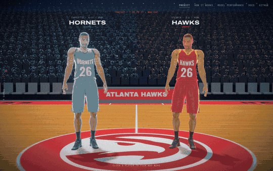
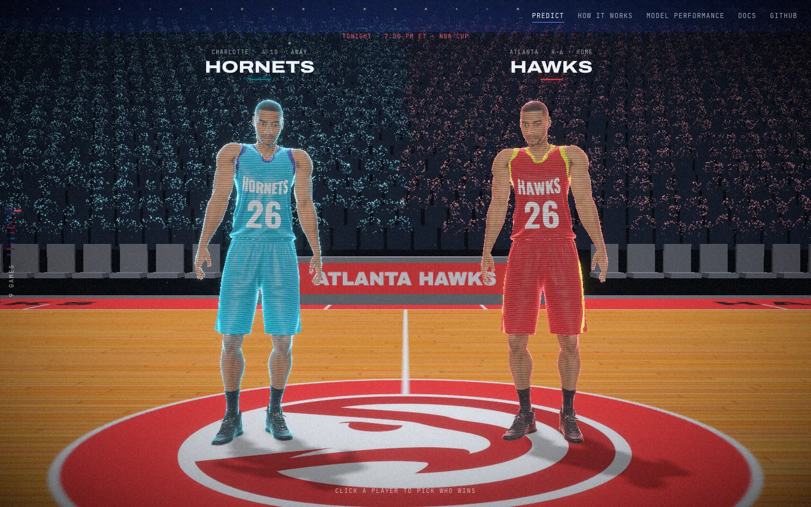
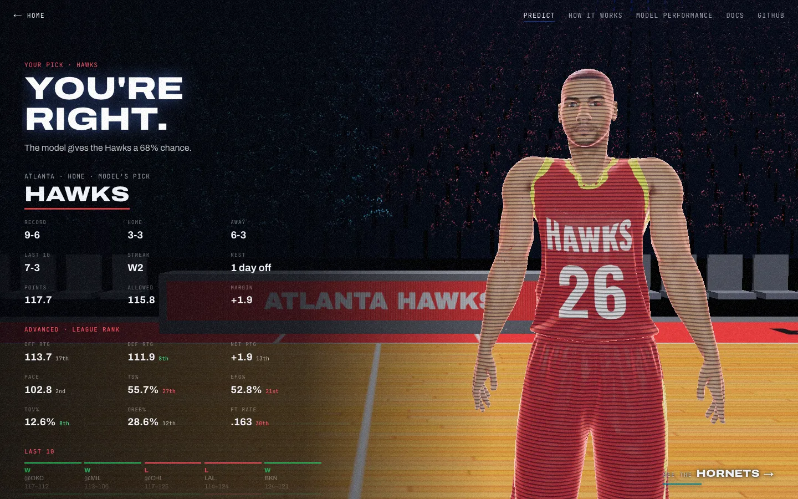
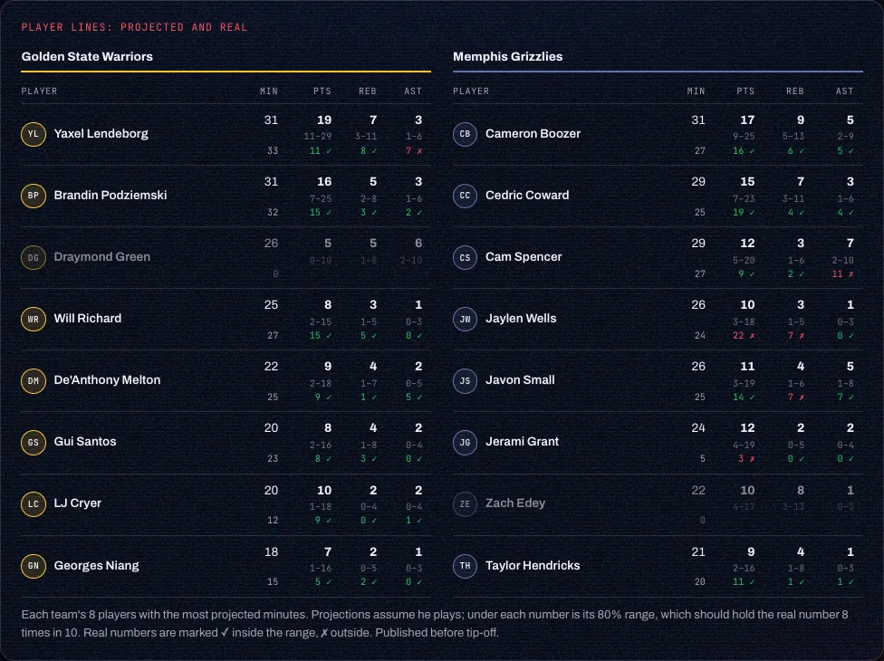
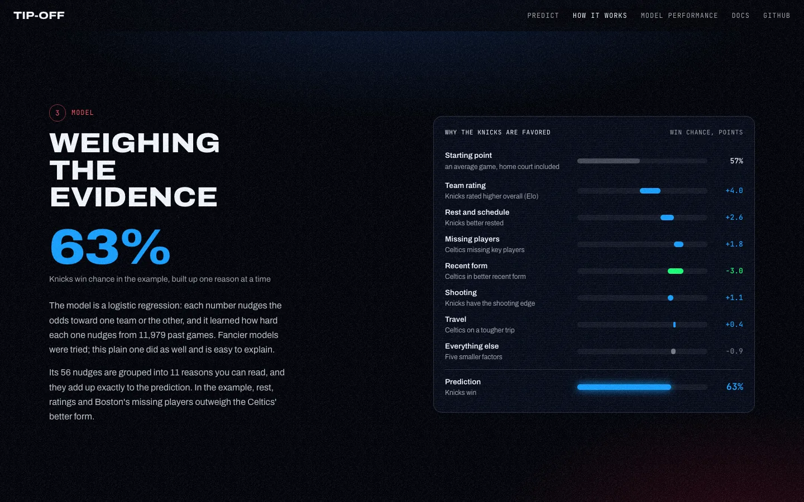
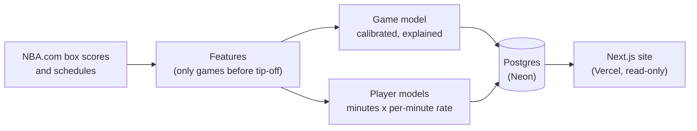

# Tip-Off

**Who wins tonight?** Pick the winner of any NBA game by clicking a hologram player, watch your pick take the shot, then see what the model thinks: the win chance, the reasons behind it, both teams' numbers and each player's projected line.

**Live:** https://nba-alpha-olive.vercel.app

> Unofficial fan project. Not affiliated with or endorsed by the NBA or any team. Not betting advice.



## What's on the site

- **Predict** (home): tonight's games in a 3D arena drawn in light. Click a player to pick his team; he shoots. It goes in if your pick is right (by the final score once a game is over, by the model's call before then). The results screen shows the verdict, the team's season numbers, its top 5 projected player lines, the model's win chance next to a simple Elo baseline, and the reasons in plain words ("Hawks better rested").
- **Game pages** (`/game/[id]`): everything about one game, including both teams' 8 projected player lines with their 80% ranges, and the real numbers marked against them once it's final.
- **Model performance** (`/performance`): the model graded on every finished game next to Elo and "always pick the home team": accuracy, log loss, Brier score, a rolling accuracy chart, calibration, the best and worst calls, and every recent pick.
- **How it works** (`/how-it-works`): a five-chapter scroll story from box scores to the 3D shot, following one example game.
- **Docs** (`/docs`): the technical write-up: data, features, leakage, models, calibration, explanations, player projections, the pipeline and the limitations.

| | |
|---|---|
|  |  |
|  |  |
|  |  |

<p align="center"></p>

## How good it is

Every model was chosen on the 2024-25 season and then scored **once** on 2025-26, a season held out of every decision. The site grades itself on every game since.

**Game outcomes** (2025-26, 1,230 games):

| | Accuracy | Log loss |
|---|---|---|
| Always pick the home team | 55.5% | 0.687 |
| Elo ratings | 69.2% | 0.598 |
| **Tip-Off model** | 67.1% | 0.602 |

The model clearly beats picking the home team and is close to Elo, but behind it on that season (the gap isn't statistically meaningful; the model led on the validation season). Good NBA game models land in the mid to high 60s, and the site doesn't promise more. Elo stays on the report card as the benchmark to beat.

**Player lines** (2025-26, 23,170 player-games): average miss of the model vs each player's last-10 average.

| | Last-10 average | Model | 80% range held |
|---|---|---|---|
| Minutes | 5.08 | 4.73 | |
| Points | 4.88 | 4.73 | 81.3% |
| Rebounds | 2.00 | 1.94 | 81.1% |
| Assists | 1.44 | 1.40 | 80.7% |

## How it works



- **Data:** every regular-season game since 2015-16 (about 13,000), team and player box scores, cached on disk.
- **Features:** 56 numbers per game (ratings, form, shooting, rest, travel, who's missing) and 47 per player-game, all built only from games before tip-off. Leakage tests perturb a day's results and delete the future, and the features must not change.
- **Game model:** a calibrated logistic regression blended with a small LightGBM. Each prediction is split exactly into 11 readable reasons.
- **Player model:** projected minutes times projected per-minute rates (LightGBM), with quantile models and a conformal correction for the 80% ranges.
- **In production:** a GitHub Actions job pulls the history from Postgres each morning, adds last night's games from cdn.nba.com box scores, predicts today's games and publishes them before tip-off. A weekly job refits both models and promotes a refit only if it's no worse than what was published. The website never runs a model; it only reads.

More in the [technical docs](https://nba-alpha-olive.vercel.app/docs) and in [`docs/`](docs/).

## Tech stack

- **ML:** Python 3.12, uv, pandas, scikit-learn, LightGBM, MLflow, pandera, pytest, ruff
- **Data:** Postgres on Neon; Drizzle (the schema) on the web side, SQLAlchemy on the Python side
- **Web:** Next.js 16 (App Router, Cache Components), TypeScript, Tailwind CSS, three.js with React Three Fiber, drei and postprocessing, GSAP, zustand, Recharts, MDX
- **Hosting:** Vercel (site), Neon (database), GitHub Actions (daily predictions, weekly retrain, score sync)

## Repo layout

```
ml/        Python pipeline (uv): ingest, features, models, predict, publish, the `tipoff` CLI
web/       Next.js site: the 3D scene, pages, MDX docs, the database schema (lib/db/schema.ts)
shared/    teams.json (ids, names, colors) and factors.json (the readable reasons)
docs/      planning specs: PRD, design, architecture, ML plan, asset pipeline, roadmap
.github/   CI and the scheduled jobs
```

## Getting started

Requirements: Python 3.12 with [uv](https://docs.astral.sh/uv/), Node 26, pnpm 12 (`npm i -g pnpm@12`), Docker for the local database, and on macOS `brew install libomp` (for LightGBM).

```bash
cp .env.example .env            # then fill in the database URLs
docker compose up -d db         # local Postgres (port 5433) for development and tests

cd ml
uv sync
uv run pytest
uv run tipoff --help

cd ../web
pnpm install
pnpm db:migrate && pnpm db:seed
pnpm dev                        # http://localhost:3000
```

Historical ingest (`uv run tipoff ingest`) calls stats.nba.com, which blocks cloud IP ranges: run it on your own machine. Everything the scheduled jobs need comes from cdn.nba.com. See [`CLAUDE.md`](CLAUDE.md) for every command and [`docs/ROADMAP.md`](docs/ROADMAP.md) for what was built when.

## Scheduled jobs

| When (ET) | Job | What it does |
|---|---|---|
| Hourly, about 9 AM to 6 PM | `daily` | New box scores, then today's predictions and player lines, published before tip-off; stops once today is done |
| Mondays, about 7 AM | `retrain` | Refits both models; promotes a refit only if it's no worse than what was published over the last 4 weeks; opens an issue otherwise |
| Daily, about 6 AM | `schedule-sync` | Schedule changes (times, postponements, new games) |
| Hourly, about 6 PM to 2 AM | `results-sync` | Live scores and finals |
| Daily, about 10:30 AM | `freshness-check` | Fails (and GitHub emails) if a game has no prediction |

A local fallback for the daily job can be installed on a Mac (`ml/scripts/install_launchd.sh`); it acts only if the cloud job hasn't published. It isn't needed while the cloud job runs.

## Credits

The 3D player was generated for this project with Meshy; the arena, platforms, hoop and effects are drawn in code. Team names and colors only: no league or team logos, wordmarks or real player likenesses. Data from NBA.com's public endpoints. Full credits in [`web/public/CREDITS.md`](web/public/CREDITS.md).

## License

MIT. See [`LICENSE`](LICENSE).
