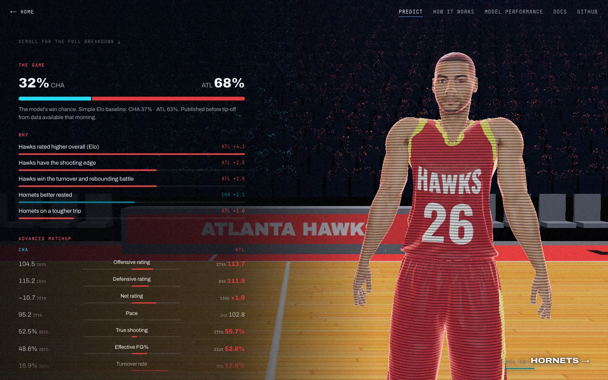
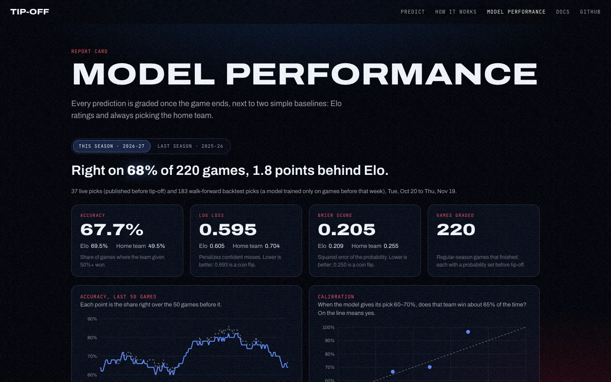
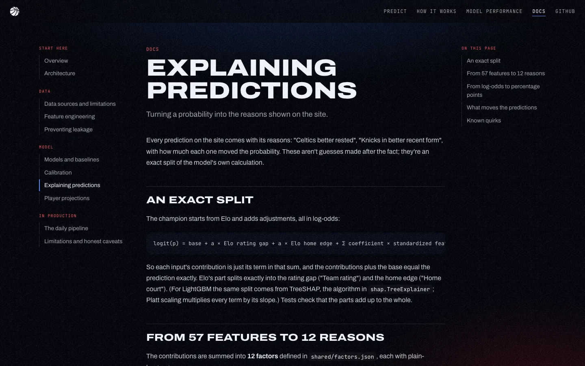
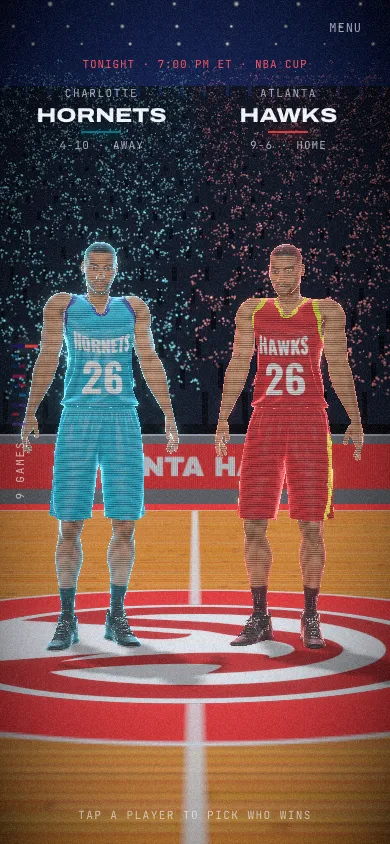
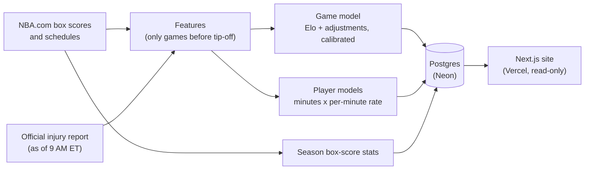

# NBA Game Predictor

**Who wins tonight?** Pick the winner of any NBA game by clicking a hologram player on a 3D court, watch your pick take the shot, then see what the model thinks: the win chance, the reasons behind it, both teams' numbers and advanced stats, and each player's projected line.

**Live:** https://nba-alpha-olive.vercel.app

> Unofficial fan project. Not affiliated with or endorsed by the NBA or any team. Not betting advice.


## What's on the site

- **Predict** (home): tonight's games, one at a time, as two hologram players standing at center court in the home team's arena. Hover a player and he pops out; click him to pick his team. The other player fades away, the camera swings round, and your pick shoots at the far basket. It goes in if your pick is right (by the final score once a game is over, by the model's call before then). The results sit beside a close-up of the player: the verdict, the team's record, form and scoring, its advanced stats with league ranks, its last 10 games and its top 8 projected player lines. Scroll the same column for the full breakdown: the model's win chance next to a simple Elo baseline, the reasons in plain words ("Hawks better rested"), the advanced matchup, the season series and the other team. A corner button switches to the other team.
- **Game pages** (`/game/[id]`): the same breakdown for one game on a shareable page, with both teams' 8 projected player lines (80% ranges, true shooting and usage) and the real numbers marked against them once it's final.
- **Model performance** (`/performance`): the model graded on every finished game next to Elo and "always pick the home team": accuracy, log loss, Brier score, a rolling accuracy chart, calibration, the best and worst calls, and every recent pick, for this season and last.
- **How it works** (`/how-it-works`): a five-chapter scroll story from box scores to the 3D shot, following one example game.
- **Docs** (`/docs`): the technical write-up: data, features, leakage, models, calibration, explanations, player projections, the pipeline and the limitations.

| | |
|---|---|
|  |  |
|  |  |
|  |  |



<p align="center"></p>

## How good it is

Every model is chosen without looking at the 2025-26 season, then scored on it **once** (the rules allow one re-test for a new major version, which the current models, game v4 and player v2, used). The site grades itself on every game since.

**Game outcomes** (2025-26, 1,230 games, model v4):

| | Accuracy | Log loss | Brier |
|---|---|---|---|
| Always pick the home team | 55.5% | 0.687 | 0.247 |
| Elo ratings | 69.2% | 0.598 | 0.205 |
| **The model** | 68.1% | **0.587** | **0.201** |

The model beats Elo on log loss, Brier score and AUC, the measures of how good its probabilities are, and that edge holds up statistically (log-loss gap −0.011, 95% interval −0.020 to −0.002); Elo still picked about one more winner in a hundred. The model was chosen on six held-out seasons (2019-20 to 2024-25), each predicted by a model trained only on the seasons before it, and it beat Elo on log loss in all six. The biggest recent gain came from the league's official injury report, read as it stood at 9 AM Eastern on game day (and again at 5:45 PM to update games that haven't started). Good NBA game models land in the mid to high 60s for accuracy, and the site doesn't promise more. Elo stays on the report card as the benchmark to beat, including this season, where the [performance page](https://nba-alpha-olive.vercel.app/performance) shows the live record.

**Player lines** (2025-26, 23,170 player-games): average miss of the model vs each player's last-10 average.

| | Last-10 average | Model | 80% range held |
|---|---|---|---|
| Minutes | 5.08 | 4.66 | |
| Points | 4.88 | 4.71 | 80.9% |
| Rebounds | 2.00 | 1.93 | 80.7% |
| Assists | 1.44 | 1.40 | 82.2% |

## How it works



- **Data:** every regular-season game since 2015-16 (about 13,000), team and player box scores, cached on disk.
- **Features:** 61 numbers per game (ratings, form, shooting, rest, travel, who's missing, lineup strength, the injury report) and 51 per player-game, all built only from games before tip-off and the injury report published before the prediction. Leakage tests perturb a day's results and delete the future, and the features must not change. Lineup strength rates each player by his Game Score per minute and weights him by his recent minutes, so it notices who has been out.
- **Game model:** starts from Elo's log-odds and learns adjustments from 37 features (rest, travel, availability, lineup strength, the injury report, recent form, home and road records), with a penalty on the adjustments only, so a noisy input can't pull it far from Elo; then Platt calibration. It was picked over logistic regression, LightGBM and an ensemble of the two. Each prediction is split exactly into 13 readable reasons.
- **Player model:** projected minutes times projected per-minute rates (LightGBM), with quantile models and a conformal correction for the 80% ranges. Players listed Out or Doubtful aren't projected; teammates' expected absences feed the minutes.
- **Advanced stats:** offensive, defensive and net rating, pace, the Four Factors with league ranks, and each player's true shooting, usage and recent scoring, computed on the site from season box scores the pipeline stores, using only games before the day.
- **In production:** a GitHub Actions job pulls the history from Postgres each morning, adds last night's games from cdn.nba.com box scores, reads the official injury report, predicts today's games and publishes them before tip-off, and re-publishes in the evening with the latest report. A weekly job refits both models and promotes a refit only if it's no worse than what was published. The website never runs a model; it only reads.

More in the [technical docs](https://nba-alpha-olive.vercel.app/docs) and in [`docs/`](docs/).

## Tech stack

- **ML:** Python 3.12, uv, pandas, scikit-learn, LightGBM, Optuna, MLflow, pandera, pytest, ruff
- **Data:** Postgres on Neon; Drizzle (the schema) on the web side, SQLAlchemy on the Python side
- **Web:** Next.js 16 (App Router, Cache Components), TypeScript, Tailwind CSS, three.js with React Three Fiber, drei and postprocessing, GSAP, zustand, Recharts, MDX
- **Hosting:** Vercel (site), Neon (database), GitHub Actions (daily predictions, weekly retrain, score sync)

## Repo layout

```
ml/            Python pipeline (uv): ingest, features, models, predict, publish, the `tipoff` CLI
web/           Next.js site: the 3D scene, pages, MDX docs, the database schema (lib/db/schema.ts)
shared/        teams.json (ids, names, colors) and factors.json (the readable reasons)
docs/          planning specs: PRD, design, architecture, ML plan, asset pipeline, roadmap
scripts/       the pre-push git hook
pipeline.yaml  local CI (the same checks as GitHub Actions)
.github/       CI and the scheduled jobs
```

## Getting started

Requirements: Python 3.12 with [uv](https://docs.astral.sh/uv/), Node 26, pnpm 12 (`npm i -g pnpm@12`), Docker for the local database, and on macOS `brew install libomp` (for LightGBM).

```bash
cp .env.example .env            # then fill in the database URLs
docker compose up -d db         # local Postgres (port 5433) for development and tests

cd ml
uv sync
uv run pytest
uv run tipoff --help

cd ../web
pnpm install
pnpm db:migrate && pnpm db:seed
pnpm dev                        # http://localhost:3000
```

Historical ingest (`uv run tipoff ingest`) calls stats.nba.com, which blocks cloud IP ranges: run it on your own machine. Everything the scheduled jobs need comes from cdn.nba.com. See [`CLAUDE.md`](CLAUDE.md) for every command and [`docs/ROADMAP.md`](docs/ROADMAP.md) for what was built when.

## Scheduled jobs

| When (ET) | Job | What it does |
|---|---|---|
| Hourly, about 9 AM to 6 PM | `daily` | New box scores and season stats, then today's predictions and player lines, published before tip-off; stops once today is done |
| Mondays, about 7 AM | `retrain` | Refits both models; promotes a refit only if it's no worse than what was published over the last 4 weeks; opens an issue otherwise |
| Daily, about 6 AM | `schedule-sync` | Schedule changes (times, postponements, new games) |
| Hourly, about 6 PM to 2 AM | `results-sync` | Live scores and finals |
| Daily, about 10:30 AM | `freshness-check` | Fails (and GitHub emails) if a game has no prediction |

A local fallback for the daily job can be installed on a Mac (`ml/scripts/install_launchd.sh`); it acts only if the cloud job hasn't published. It isn't installed now: the cloud job has run cleanly every day.

## Credits

The 3D player was generated for this project with Meshy; the arena, court, crowd, hoop and effects are drawn in code. Team names and colors, plus each home team's logo at center court (trademarks of their teams and the NBA, from NBA.com, used only to identify the team); no league logo, wordmarks or real player likenesses. Data from NBA.com's public endpoints. Full credits in [`web/public/CREDITS.md`](web/public/CREDITS.md).

## License

MIT. See [`LICENSE`](LICENSE).
